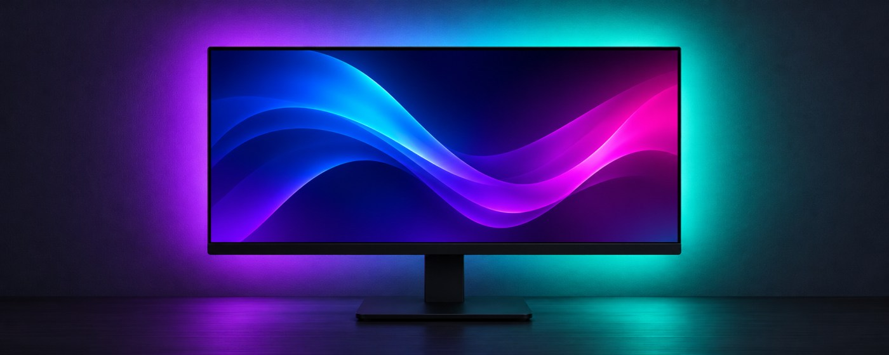
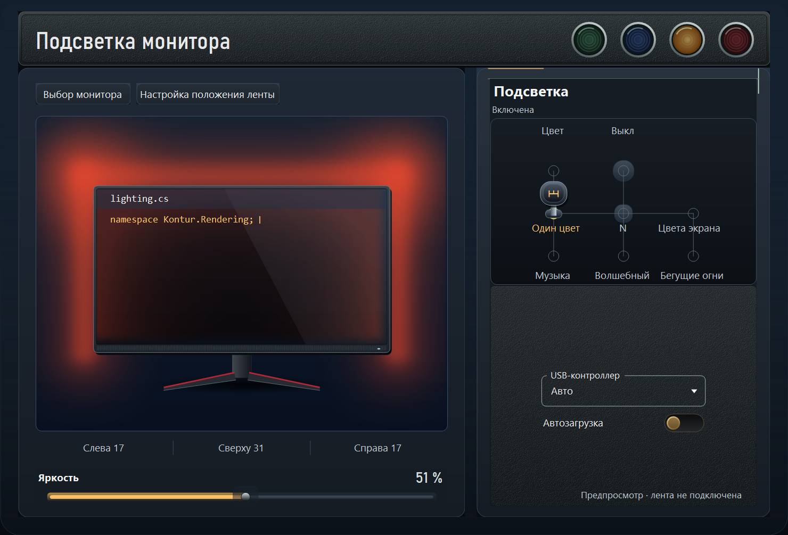

# Контур

**Синхронизируйте подсветку монитора с экраном или музыкой.** «Контур» работает на Windows с USB-контроллером SK0127 и лентой из 65 светодиодов. В окне видно, как будет выглядеть свет, ещё до подключения ленты.

[⚡ Быстрый старт](#быстрый-старт) · [📦 Установка](#установка) · [🎨 Режимы](#режимы) · [🧰 Помощь](#помощь) · [🛠 Сборка](#сборка)

## Быстрый старт

1. 🔌 **Подключите SK0127 по USB.** Закройте Skydimo через значок рядом с часами, чтобы освободить порт.
2. 🎛️ **Откройте «Контур».** В поле **USB-контроллер** оставьте **Авто**. Если адаптеров CH340 несколько, выберите COM-порт своей ленты.
3. 🌈 **Выберите режим рычагом.** Для цветов экрана откройте выбор монитора. Подберите яркость ползунком под предпросмотром. Внизу справа появится статус подключения с номером порта.



## Установка

Нужна **Windows 10 или 11 x64**. Среда .NET уже входит в сборку. Windows должна распознавать USB-контроллер CH340.

- 📦 **Установщик.** Запустите `Kontur-Setup-x64.exe`. Программа установится для вашего пользователя и появится в меню «Пуск».
- ⚡ **Переносимый EXE.** Запустите `Kontur.exe` двойным щелчком. В локальной сборке 0.9.2 оба файла находятся в папке `release-0.9.2`.

При первом запуске порт свободен. Крестик сворачивает окно в область уведомлений Windows, режим продолжает работать. Чтобы погасить ленту и освободить порт, переведите рычаг вверх или выберите **Выход** в меню значка «Контур». Положение **N** гасит ленту и запоминает последний режим.

Чтобы «Контур» открывался при каждом входе в Windows, включите **Автозагрузку** под полем USB-контроллера. Настройка действует для текущего пользователя. Если перенесёте переносимый EXE, выключите и снова включите переключатель, чтобы обновить путь.

Настройки и журнал остаются в `%LOCALAPPDATA%\KonturSK0127`. Установленную программу можно удалить через **Параметры Windows → Приложения**.

## Режимы

| Режим | Что увидите |
| --- | --- |
| 🎨 **Один цвет** | Один оттенок на всей ленте. Палитра открывается верхним положением левой ветки рычага. |
| 🖥️ **Цвета экрана** | Цвета повторяют края выбранного монитора. Если монитор отключится, лента плавно погаснет и продолжит работу, когда монитор появится в Windows под тем же именем. |
| 🎵 **Музыка** | Подсветка реагирует на звук с основного аудиовыхода Windows. Бас, средние и высокие частоты меняют красный, зелёный и синий оттенки. |
| 🌊 **Волшебный** | Плавная цветовая волна по ленте. |
| 💫 **Бегущие огни** | Световой акцент движется вдоль ленты. |

## Помощь

- 🔍 **Контроллер не найден.** Проверьте кабель и список **Порты (COM и LPT)** в Диспетчере устройств. Если номер изменился, откройте список портов в «Контуре» и выберите новый номер или **Авто**.
- 🔒 **Порт занят.** Выйдите из Skydimo или другой программы подсветки и дождитесь следующего подключения.
- 🖥️ **Экран недоступен.** Проверьте выбранный монитор в панели выбора. HDR, защищённое видео и эксклюзивный полноэкранный режим могут захватываться некорректно.
- 🎧 **Музыка не меняет цвета.** Проверьте, что звук идёт через устройство вывода, выбранное по умолчанию в Windows. Журнал ошибок находится в `%LOCALAPPDATA%\KonturSK0127\kontur.log`.

## Сборка

<details>
<summary>🛠️ Команды для Windows с .NET 8 SDK и NSIS 3</summary>

```powershell
pwsh -File .\installer\Build-Installer.ps1
```

Если `makensis.exe` отсутствует в PATH, передайте полный путь через `-MakeNsis`. Скрипт публикует автономный EXE для Windows x64, собирает установщик и записывает контрольные суммы в `SHA256SUMS.txt`.

Для проверки из корня репозитория:

```powershell
$exe = '.\release-0.9.2\Kontur.exe'
Start-Process $exe -ArgumentList '--self-test .\release-0.9.2\protocol.txt' -Wait
Start-Process $exe -ArgumentList '--ui-test .\release-0.9.2\preview' -Wait
```

Протокольный тест проверяет кадры, выбор порта и восстановление после сбоя. Тест интерфейса сохраняет результат и снимки окна в `preview`. Оба работают без открытия COM-порта.

</details>

[Архитектура](docs/architecture/README.md) · [План](PLAN.md) · [Статус](STATUS.md)
